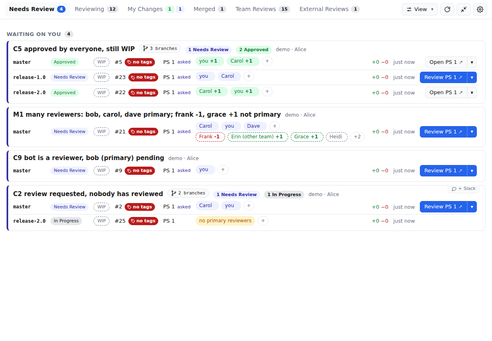

# Gerrit Review Board

A desktop app for Gerrit 3.11 on macOS, Windows, and Linux. It tracks review
requests for each patch set and shows what needs your attention.



## Get started

Download a build from [Releases](https://github.com/MTVaught/gerrit-gui/releases).
On first launch, enter your Gerrit URL, username, and HTTP password, then
select "Test and save". Create the password in Gerrit under Settings > HTTP
Credentials.

Use the HTTPS base URL, including any path prefix, such as
`https://gerrit.example.com/gerrit`. The app uses your system proxy and
Chromium's certificate store. For a private CA, see the
[connection checks](docs/testing.md#gerrit-transport-security).

The desktop app saves passwords only when a secure OS keychain is available.
Otherwise, the password stays in memory until you quit. Enter a new password
if you change the server or username.

In Settings, add your team and the people who can merge each project's changes.
Teams control which backlogs you see. Primary reviewers on each change decide
its review state.

## Review flow

1. Push a change and use the "+" button to add primary reviewers.
2. Select "Request review" when the patch set is ready. Choose pass-around
   review for individual reviews, or in-person review to go through it together.
3. Primary reviewers open "Needs Review", select "Review", and vote +1 or -1.
   The diff starts at their last reviewed patch set, or at base on a first review.
4. After every primary reviewer votes, the change is "Approved" if all votes
   are +1, or "Needs Changes" if any vote is -1. Other reviewers' votes do not
   decide this state.
5. Push fixes and request review again for the new patch set. A push alone
   does not request another review.
6. Once approved, mark the change Active and wait for Verified +1 from CI.
   Select "Ready to Merge" and name the person who will merge it.
7. That person gets the request on the "Merged" tab and submits it in Gerrit.

WIP does not block review. It blocks "Ready to Merge" until the change is Active.
Review requests, votes, and tags live in Gerrit; the app has no separate workflow
database.

The [walkthrough](docs/walkthrough.md) shows a full review from the author's,
reviewers', and merger's views.

## Using the board

- "Needs Review" lists requests waiting for your vote. "Reviewing" lists all
  open changes where you are a reviewer. "My Changes" tracks your own work.
- Configure teams to see watched backlogs and reviews from outside your team.
- Use "View" or Ctrl+F to search subjects, filter by author, or change the sort.
- Changes with the same Change-Id share a card, with a row per branch. Group
  dependent changes into a sequence to show their review order. Votes and
  actions apply to each change separately.
- The tray menu shows pending work and opens a compact board. Closing the main
  window hides it in the tray. Use "Quit" in the tray menu to stop the app.

Reviews open in Gerrit by default. Enable "Open reviews in the app" under
Settings > Beta to use the local diff viewer, comments, drafts, and voting.
Enable "Open reviews in separate windows" under Settings > Window if needed.
Press `?` in a review for keyboard shortcuts. Drafts save to Gerrit and stay
private until you send the review.

Release builds check for updates at startup and once an hour. Download and
installation each need a click. You can also check from Settings > About.
On macOS, automatic updates require a signed release build.

## Development

Use Node 22 or later and the pnpm version in `package.json`. Run
`corepack enable` once, then:

```sh
pnpm install
pnpm dev           # desktop app with hot reload
pnpm build         # production build
pnpm start         # run the production build
pnpm dist          # package installers in dist/
```

The scripts download the Electron binary if needed. On Ubuntu 24.04 and later,
they show a one-time sandbox setup command if the kernel blocks Electron.

### Browser mode

To work without a desktop display:

```sh
pnpm web
```

Open the one-use link printed after Vite starts. Keep the link private. The UI
runs at `http://localhost:5173` and the local API at `127.0.0.1:5174`. Both bind
to loopback. Browser mode has no tray, app badge, or compact window.

Passwords stay in the server process memory until restart. Settings go in
`~/.config/gerrit-gui/web-settings.json`. You can also set `GERRIT_URL`,
`GERRIT_USER`, and `GERRIT_PASSWORD` in the environment.

For different ports, set all three values:

```sh
WEB_PORT=5183 API_PORT=5184 WEB_ORIGIN=http://localhost:5183 pnpm web
```

For remote port forwarding, set `WEB_ORIGIN` to the exact HTTPS browser origin
and preserve the Host and Origin headers. Keep the development server private.

### Tests

```sh
pnpm typecheck
pnpm test
```

Integration tests need a local Gerrit fixture with dummy accounts:

```sh
docker run -d --name gerrit-test -p 127.0.0.1:8080:8080 gerritcodereview/gerrit:3.11.2
./test/seed-gerrit.sh
./test/seed-more-states.sh
GERRIT_GUI_ALLOW_LOCAL_TEST_HTTP=1 pnpm test:integration
```

The HTTP test flag permits only `127.0.0.1` and `[::1]`, not `localhost` or
remote hosts. Use dummy credentials only. Normal connections require HTTPS.

See [testing](docs/testing.md) for UI checks, screenshots, and transport tests.

## More documentation

- [Review walkthrough](docs/walkthrough.md)
- [Workflow design](docs/design/primary-reviewers.md)
- [Team setup](docs/design/teams.md)
- [Merge requests](docs/design/merge-request.md)
- [Fallback Gerrit dashboard](gerrit-dashboard/README.md)
